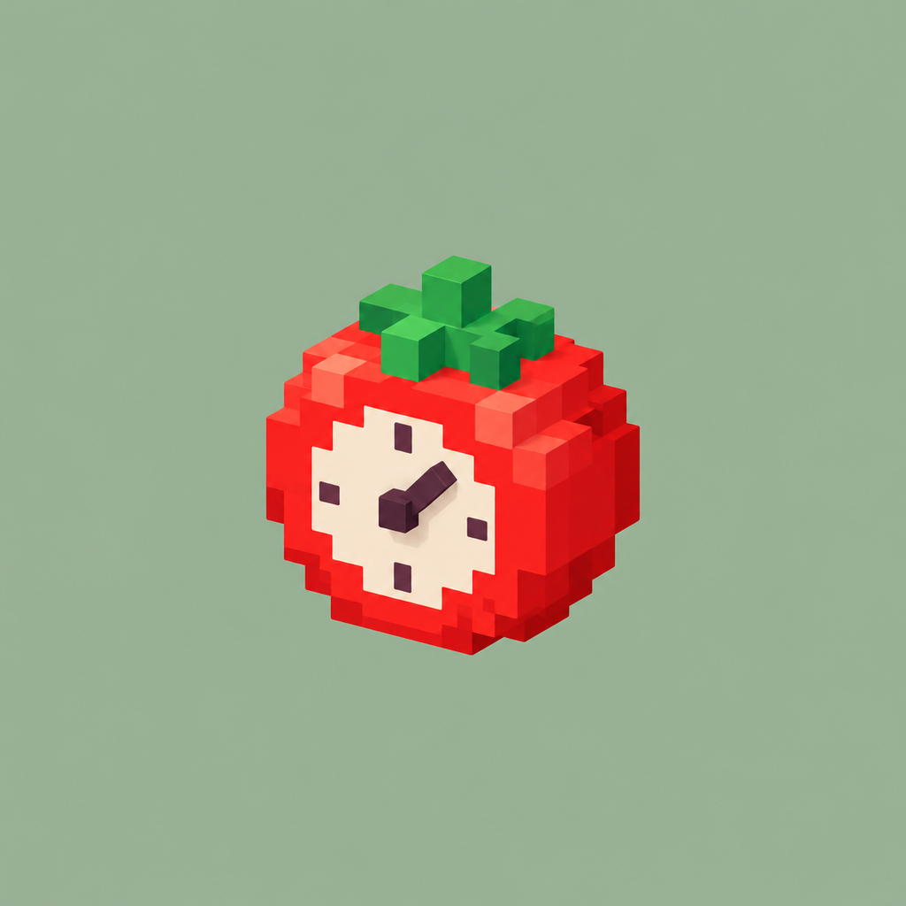

<p align="center"></p>

# Pomodoro Terrarium

A cozy pomodoro timer where an isometric voxel garden island grows while you work. The island has a sky that changes with the time of day, seasonal grass, a little cabin with chimney smoke and a lily pond. Each island starts fresh, with no trees until you grow them. Reimagined from
[typing-speed-terrarium](https://github.com/dalecri/typing-speed-terrarium).

- **Seven islands**: *Blossom Hollow* (wood cabin, olive pond), *Amber Mill* (stone windmill with turning sails, ducklings), *Moonlit Greenhouse* (glass greenhouse, koi), *Corner Café* (pink café with a striped awning, spinning rooftop fan, fountain), *Lavender Flats* (three-storey flats, laundry on the roof, windows that switch on at night, goldfish), *Glass Florist* (flower shop with spinning vents, buckets of blooms, koi) and *Lighthouse Point* (striped lighthouse with a sweeping beam, sailboat). New users pick one in the intro, and each new garden in the album starts on a different island.
- **Time of day**: morning, afternoon, golden hour and night follow your local clock, with changing skies, moving sunlight and shadows, drifting voxel clouds, stars and nighttime glow. In Settings → Time of day, pick a time or choose **Focus & breaks** for timer-driven lighting. Short breaks still water the garden with rain.
- **Quebec seasons**: the island follows the calendar in Quebec's time zone. Winter (Dec–Mar) brings snow on the roofs and ground, frosted trees, a frozen pond and snowfall. Fall (Sep–Nov) turns the trees maple red and scatters leaves. Preview any season from settings.
- **More land**: buy the Meadow expansion (13×13) and the Grand estate (15×15) in the shop's Land tab. Everything already planted stays put.
- **The family cats**: Diego (rosetted Bengal), Ramses (spotted Savannah), Cali (calico) and Neo (white with grey tabby patches) roam the island, groom, and nap at night. Adopt them free from the Critters tab.
- **Focus chart**: pomodoros per day as a 7-day bar chart or a 16-week heatmap, with per-day details on hover.
- **Focus**: a mystery seed sprouts and grows a block at a time as the timer runs, then blooms when it finishes.
- **Stop early**: the sprout wilts. If you stop in the first minute, the seed just goes back in your pocket.
- **Finish a task**: it revives a wilted sprout, or pops up something small like a mushroom, moss or a tulip.
- **Short break**: a rain cloud waters the island. At **night**, stars, fireflies and crickets appear; **Focus & breaks** lighting keeps the original dusk/night break effects.
- **Every 4th pomodoro** grows a cherry blossom tree.
- **Critter journal**: butterflies, a snail, a ladybug, fireflies, a frog. Each has its own milestone.
- **Hover any plant** to see which task it grew during. Drag to turn the island. Zoom in with the mouse wheel, a trackpad pinch or a two-finger pinch on touch screens, and drag to look around while zoomed. Double-click (or double-tap) to reset the view.
- **Garden album**: when the island fills up (93 plots), save a snapshot to the album and start fresh.
- **Coins & shop**: each finished task earns 2 coins and each bloom earns 3. Spend them in the garden shop (press <kbd>S</kbd>):
  - **Flowers** (6 to 25 coins): lavender, cactus, rose, lily of the valley, Venus flytrap, a glowing moonflower, bonsai, rainbow tulip. Each one is planted right away.
  - **Critters** (15 to 45 coins): a bumblebee, a bunny, a night owl on the fence, and a sleepy cat on the cabin roof.
  - **Accents** (10 to 35 coins): mossy boulders, a lamp post, a garden gnome, fairy lights, and a hot-air balloon.
  - Critters and accents are yours to keep, and you can put them away and bring them back.

Everything is saved in `localStorage`, including a running timer, so you can close the tab and come back.

## Run

```bash
python -m http.server 5179
```

Then open http://localhost:5179. To try things quickly, turn on **Settings → Test mode** so timers count in seconds (a badge on the timer shows it's on; test sessions don't count toward focus time). **Settings → Island** switches between the seven islands at any time.

First-time visitors get a short 5-step walkthrough (replay it from settings: "Show the intro again").

Keys: <kbd>Space</kbd> start/pause · <kbd>N</kbd> new task · <kbd>Esc</kbd> close panels (mobile).

The master logo is `assets/logo-source.png`. `python scripts/make-logo-assets.py` (needs Pillow) makes every icon from it: the app tile, the transparent tomato, the favicon, the home-screen icon and the Android icon and splash sources in `resources/`.

## Google Tasks sync

Settings → **Google Tasks → Connect** links the app to a list called **Focus** in your Google Tasks (created if missing). Sync goes both ways: tasks added to that list anywhere (Google Tasks, Gmail, assistants like Muse) appear in the app, and tasks added, completed, deleted or cleared in the app update Google. A task completed outside the app still grows a plant and earns coins, once. The app syncs on open, on return to the foreground, every few minutes while open, and shortly after any change; edits made offline are queued. If both sides edit the same task, the newer edit wins.

Setup: a Google Cloud project with the Tasks API enabled, an OAuth consent screen with the `.../auth/tasks` scope (your account as a test user), a **Web** client (origin `http://localhost:5179`, its ID is in `app.js`) and an **Android** client (package `com.pomodoroterrarium.app` plus your signing key's SHA-1). While the consent screen is in testing mode, Google signs you out every 7 days; tap **Reconnect**.

## Android app

The Android app is a [Capacitor](https://capacitorjs.com) wrapper. three.js and the fonts are bundled, so it works fully offline. Your garden is saved in an on-device SQLite database (`storage.js`), so it survives Android clearing WebView storage, app updates and force-stops. To build a sideloadable debug APK at `dist/pomodoro-terrarium.apk` (needs JDK 21 and the Android SDK):

```bash
npm install
```

```bash
npm run apk
```

**Automatic builds:** every push runs `.github/workflows/build-apk.yml`, which builds the APK and publishes it as a pre-release on the [Releases page](https://github.com/dalecri/pomodoro-terrarium/releases), so you can download it straight to a phone. The repository secret `ANDROID_DEBUG_KEYSTORE` (your `~/.android/debug.keystore`, base64-encoded) makes those builds signed with the same key as local ones, so they install over an existing copy of the app and Google Tasks sign-in works.

The launcher icons and splash screens are made from `resources/` with `npx @capacitor/assets generate --android --assetPath resources`.
