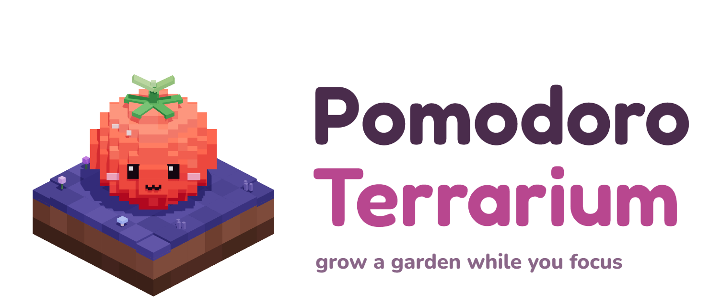

<p align="center"></p>

# Pomodoro Terrarium

A cozy pomodoro timer where an isometric voxel garden island grows while you work. The island has a dusky-mauve sky, indigo grass, a little cabin with chimney smoke, a lily pond and old blossom trees. Reimagined from
[typing-speed-terrarium](https://github.com/dalecri/typing-speed-terrarium).

- **Three islands**: *Blossom Hollow* (wood cabin, magenta blossoms, olive pond), *Amber Mill* (stone windmill, autumn maples, ducklings) and *Moonlit Greenhouse* (glass greenhouse, frost blossoms, koi). New users pick one in the intro, and each new garden in the album starts on a different island.
- **Quebec seasons**: the island follows the calendar in Quebec's time zone. Winter (Dec–Mar) brings snow on the roofs and ground, frosted trees, a frozen pond and snowfall. Fall (Sep–Nov) turns the trees maple red and scatters leaves. Preview any season from settings.
- **More land**: buy the Meadow expansion (13×13) and the Grand estate (15×15) in the shop's Land tab. Everything already planted stays put.
- **The family cats**: Diego (rosetted Bengal), Ramses (spotted Savannah), Cali (calico) and Neo (white with grey tabby patches) roam the island, groom, and nap at night. Adopt them free from the Critters tab.
- **Focus chart**: pomodoros per day as a 7-day bar chart or a 16-week heatmap, with per-day details on hover.
- **Focus**: a mystery seed sprouts and grows a block at a time as the timer runs, then blooms when it finishes.
- **Stop early**: the sprout wilts. If you stop in the first minute, the seed just goes back in your pocket.
- **Finish a task**: it revives a wilted sprout, or pops up something small like a mushroom, moss or a tulip.
- **Short break**: dusk, with a rain cloud watering the island. **Long break**: night, with stars, fireflies and crickets.
- **Every 4th pomodoro** grows a cherry blossom tree.
- **Critter journal**: butterflies, a snail, a ladybug, fireflies, a frog. Each has its own milestone.
- **Hover any plant** to see which task it grew during. Drag to turn the island; double-click to reset.
- **Garden album**: when the island fills up (93 plots), save a snapshot to the album and start fresh.
- **Coins & shop**: each finished task earns 2 coins and each bloom earns 3. Spend them in the garden shop (press <kbd>S</kbd>):
  - **Flowers** (6 to 25 coins): lavender, cactus, rose, lily of the valley, Venus flytrap, a glowing moonflower, bonsai, rainbow tulip. Each one is planted right away.
  - **Critters** (15 to 45 coins): a bumblebee, a bunny, a night owl on the fence, and a sleepy cat on the cabin roof.
  - **Accents** (10 to 35 coins): mossy boulders, a lamp post, a garden gnome, fairy lights, and a hot-air balloon.
  - Critters and accents are yours to keep, and you can put them away and bring them back.

Everything is saved in `localStorage`, including a running timer, so you can close the tab and come back.

## Run

```bash
python -m http.server 5179
```

Then open http://localhost:5179. Add `?speed=60` to make a minute pass every second for demos.

First-time visitors get a short 5-step walkthrough (replay it from settings: "Show the intro again").

Keys: <kbd>Space</kbd> start/pause · <kbd>N</kbd> new task · <kbd>Esc</kbd> close panels (mobile).

The logo files in `assets/` are rendered by `assets/logo-generator.html`, using the same voxel style as the app.

## Android app

The Android app is a [Capacitor](https://capacitorjs.com) wrapper. three.js and the fonts are bundled, so it works fully offline. Your garden is saved in an on-device SQLite database (`storage.js`), so it survives Android clearing WebView storage, app updates and force-stops. To build a sideloadable debug APK at `dist/pomodoro-terrarium.apk` (needs JDK 21 and the Android SDK):

```bash
npm install
```

```bash
npm run apk
```

The launcher icons and splash screens are made from `resources/`. `scripts/make-resources.html` renders those source images from the logo.
